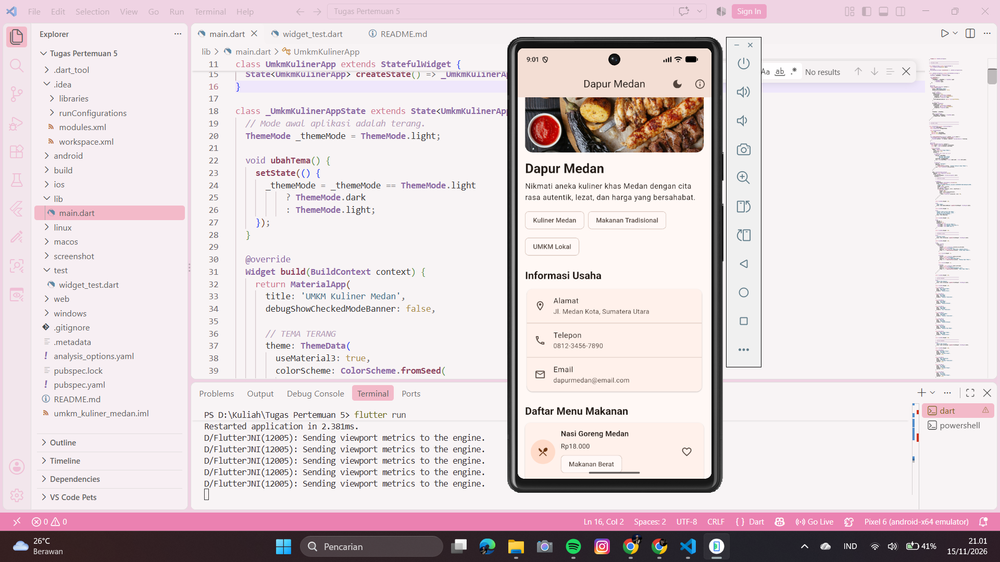
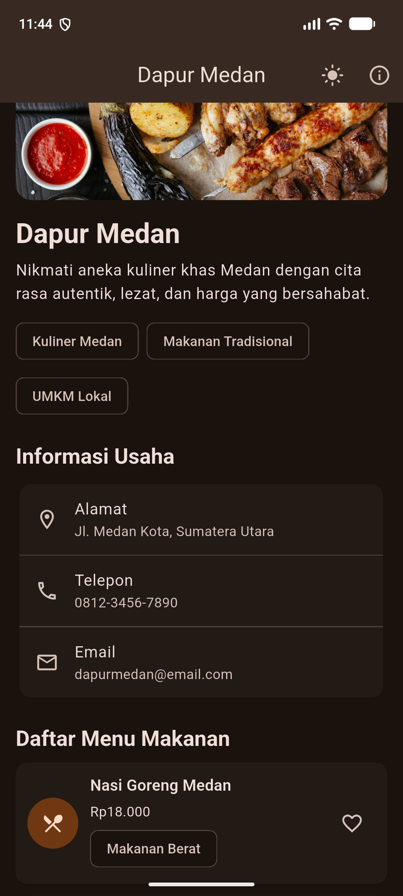

# Tugas Rutin 5 – Aplikasi UMKM Kuliner Medan

## A. Identitas

- **Nama:** Chelsea Febiola br Sebayang
- **NIM:** 4243250015
- **Mata Kuliah:** Pemrograman Mobile
- **Program Studi:** Ilmu Komputer
- **Universitas:** Universitas Negeri Medan
- **Tugas:** Pertemuan 5

## B. Deskripsi Aplikasi

**Dapur Medan** merupakan aplikasi berbasis Flutter yang dibuat untuk menampilkan informasi usaha kuliner khas Medan. Aplikasi ini menyediakan profil usaha, deskripsi, alamat, nomor telepon, dan email.

Aplikasi memiliki dua kategori menu, yaitu makanan dan minuman. Kategori makanan terdiri dari Nasi Goreng Medan, Mie Gomak, Soto Medan, Bika Ambon, Lontong Medan, Mie Sop, Mie Balap, dan Nasi Campur Medan. Sementara itu, kategori minuman terdiri dari Teh Manis Dingin, Kopi Sidikalang, Es Campur, Es Teler, dan Bandrek.

Aplikasi menyediakan fitur favorit untuk menambahkan atau menghapus menu dari daftar favorit. Selain itu, pengguna dapat mengganti tampilan aplikasi antara mode terang dan mode gelap.

## C. Screenshot Aplikasi

### 1. Mode Terang

Berikut merupakan tampilan aplikasi Dapur Medan menggunakan tema terang (Light Mode).



### 2. Mode Gelap

Berikut merupakan tampilan aplikasi Dapur Medan menggunakan tema gelap (Dark Mode).



## D. Diagram Widget Tree

Berikut merupakan struktur Widget Tree aplikasi Dapur Medan. Penanda menunjukkan widget yang menggunakan StatelessWidget dan StatefulWidget.

```text
UmkmKulinerApp (StatefulWidget)
│
└── MaterialApp
    ├── ThemeData (Light)
    ├── ThemeData (Dark)
    │
    └── HalamanUtama
        └── Scaffold
            ├── AppBar
            │   ├── IconButton (Ganti Tema)
            │   └── IconButton (Informasi)
            │
            └── SingleChildScrollView
                └── Column
                    ├── Image.network
                    ├── Text (Profil Usaha)
                    ├── Wrap (Chip)
                    ├── Card (Informasi Usaha)
                    │   └── ListTile
                    │
                    ├── Text (Menu Makanan)
                    ├── KartuMenu x 8 (StatelessWidget)
                    │
                    ├── Text (Menu Minuman)
                    ├── KartuMenu x 5 (StatelessWidget)
                    │
                    └── Buttons
                        ├── FilledButton
                        ├── OutlinedButton
                        └── TextButton

KartuMenu (StatelessWidget)
└── Card
    └── Row
        ├── CircleAvatar
        ├── Column
        └── TombolFavorit (StatefulWidget)
            └── IconButton
                └── SnackBar

Keterangan:
- StatefulWidget  : Widget yang memiliki state yang dapat berubah.
- StatelessWidget : Widget yang tampilannya bergantung pada konfigurasi
                    dan tidak mengelola state internal yang berubah.
```

## E. Penjelasan Widget Tree, Element Tree, dan Render Tree

Widget Tree merupakan struktur hierarki yang menggambarkan hubungan antarwidget dalam aplikasi Flutter. Pada aplikasi Dapur Medan, Widget Tree dimulai dari UmkmKulinerApp, kemudian MaterialApp, Scaffold, hingga widget yang menampilkan profil usaha dan daftar menu. Struktur ini membantu pengembang memahami susunan tampilan serta hubungan antara setiap komponen.

Element Tree merupakan representasi widget yang menghubungkan konfigurasi widget dengan objek yang dikelola Flutter. Element berfungsi mempertahankan identitas dan posisi widget ketika terjadi perubahan state. Dengan demikian, Flutter dapat memperbarui bagian tampilan yang berubah tanpa harus membangun ulang seluruh aplikasi.

Render Tree bertanggung jawab mengatur proses layout, ukuran, posisi, dan proses menggambar tampilan ke layar. Render Tree membuat setiap elemen visual dapat ditampilkan sesuai susunan yang telah ditentukan.

Pada aplikasi ini, StatefulWidget digunakan pada UmkmKulinerApp karena pengguna dapat mengganti tema terang dan gelap. TombolFavorit juga menggunakan StatefulWidget karena status favorit dapat berubah ketika ditekan. Sementara itu, KartuMenu menggunakan StatelessWidget karena hanya bertugas menampilkan informasi menu yang tidak memerlukan pengelolaan state internal. Pemilihan ini membuat kode lebih terstruktur, efisien, dan mudah dikembangkan.

## F. Pengujian Aplikasi

Pengujian dilakukan untuk memastikan aplikasi dapat berjalan dengan baik dan tidak memiliki kesalahan pada kode program.

Perintah yang digunakan:

```bash
dart format .
flutter analyze
flutter test
```

Hasil pengujian:

- **Dart Format:** Berhasil.
- **Flutter Analyze:** No issues found.
- **Flutter Test:** All tests passed.

## G. Teknologi yang Digunakan

- Flutter
- Dart
- Material Design 3
- Visual Studio Code
- Android Emulator
- Git dan GitHub

## H. Pernyataan Penggunaan AI

Dalam pengerjaan tugas ini, AI digunakan sebagai alat bantu untuk memahami konsep Flutter, membantu penyusunan dan perbaikan kode program, serta memberikan panduan dalam proses pengujian dan dokumentasi aplikasi. Seluruh kode dan hasil aplikasi diperiksa dan dijalankan kembali oleh mahasiswa.
